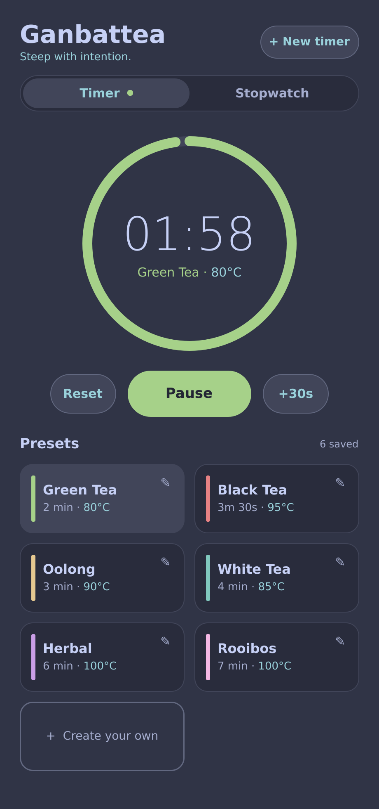
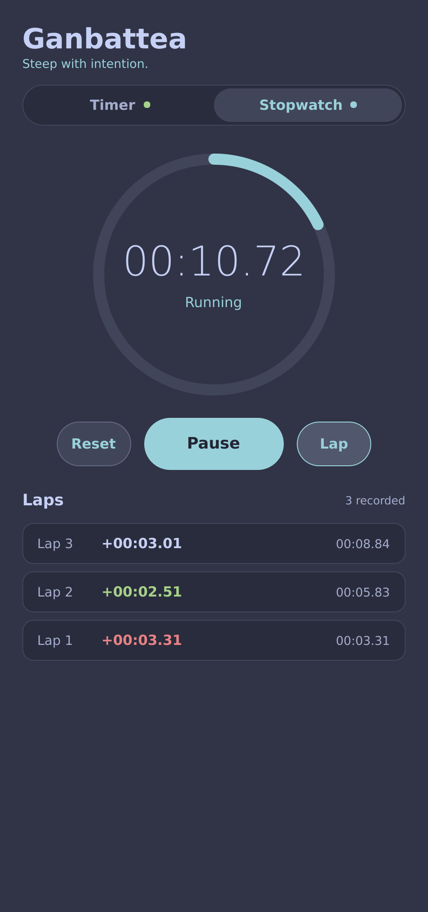
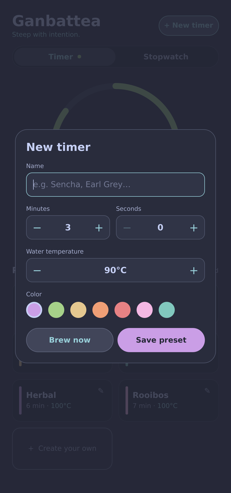
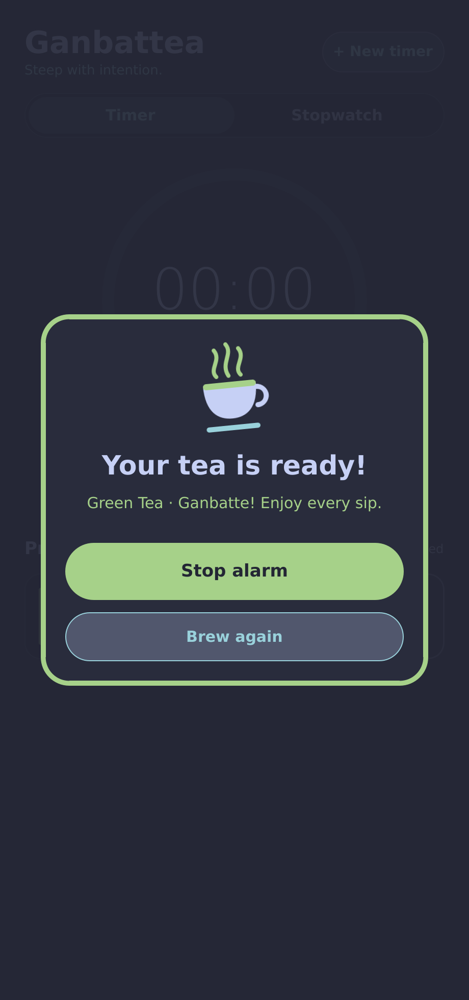

# 🍵 Ganbattea

A modern tea timer built with **Rust** and **Qt Quick (QML)**.

<table>
  <tr>
    <td align="center"><br><sub>Timer &amp; presets</sub></td>
    <td align="center"><br><sub>Stopwatch with laps</sub></td>
  </tr>
  <tr>
    <td align="center"><br><sub>Create your own timer</sub></td>
    <td align="center"><br><sub>Alarm popup</sub></td>
  </tr>
</table>

- Ring-style countdown with pause / resume / reset / +30 s
- Six built-in tea presets (green, black, oolong, white, herbal, rooibos)
- **Stopwatch** mode with lap times (fastest lap in green, slowest in red) – timer and stopwatch can run at the same time
- Create your own timers: name, duration, water temperature, color
- Save them as presets, edit or delete them any time
- "Brew now" to run a one-off timer without saving
- Alarm sound (synthesized chime, loops) plus a popup – click **Stop alarm** to silence it
- Styled with the [Catppuccin](https://catppuccin.com) **Frappé** palette: Mauve as primary, Sky as secondary color
- Presets persist as JSON in your config directory
  (`~/.config/ganbattea/presets.json`)

## Installation

Download the latest `ganbattea-<version>-linux-x86_64.tar.gz` from the
[Releases](../../releases) page, then:

```sh
tar xzf ganbattea-*-linux-x86_64.tar.gz
cd ganbattea-*-linux-x86_64
./install.sh
```

This installs the binary to `~/.local/bin`, adds **Ganbattea** to your start menu and installs the
icon – no root needed. Use `./install.sh --system` for all users (`/usr/local`, via `sudo`),
`--prefix DIR` for a custom location and `./install.sh --uninstall` to remove it again
(`--purge` also deletes your saved presets).

The app needs Qt 5.15 (Qt Quick) and ALSA/PulseAudio at runtime. If something is missing,
the installer tells you; `README.txt` inside the archive lists the packages for Debian/Ubuntu,
Fedora, Arch and openSUSE.

## Building from source

### Requirements (Linux)

- Rust (stable, 1.70+)
- Qt **5.15** with Qt Quick, with `qmake` in your `PATH`
  (Qt 6 may work via `qmetaobject`'s experimental support, but 5.15 is the tested path)

On Debian / Ubuntu:

```sh
sudo apt install build-essential libasound2-dev qtbase5-dev qtdeclarative5-dev \
    qml-module-qtquick2 qml-module-qtquick-window2 qml-module-qtquick-layouts
```

### Run

```sh
cargo run --release
```

### Install your own build

```sh
cargo build --release
./packaging/install.sh
```

## Project layout

```
ganbattea/
├── .github/workflows/release.yml
├── docs/screenshots/ # README images
├── packaging/        # installer, icon, README.txt shipped in release archives
├── Cargo.toml
├── qml/main.qml     # UI (dark theme, custom-drawn components)
└── src/main.rs      # Timer logic + preset storage, exposed to QML as `backend`
```

## Releases

`.github/workflows/release.yml` runs on every push to `main`. It builds the Linux x86_64 binary
against the distro's Qt 5, packs it with the installer into
`ganbattea-v0.1.<run number>-linux-x86_64.tar.gz` and publishes that as a new GitHub release.

The archive contains:

```
ganbattea-v0.1.N-linux-x86_64/
├── ganbattea        # the binary
├── install.sh       # installs binary, start-menu entry and icon
├── ganbattea.svg    # app icon
└── README.txt       # runtime requirements per distribution
```

## Ideas for next steps

- System tray notification
- Multi-step timers (e.g. several infusions of the same leaves)
